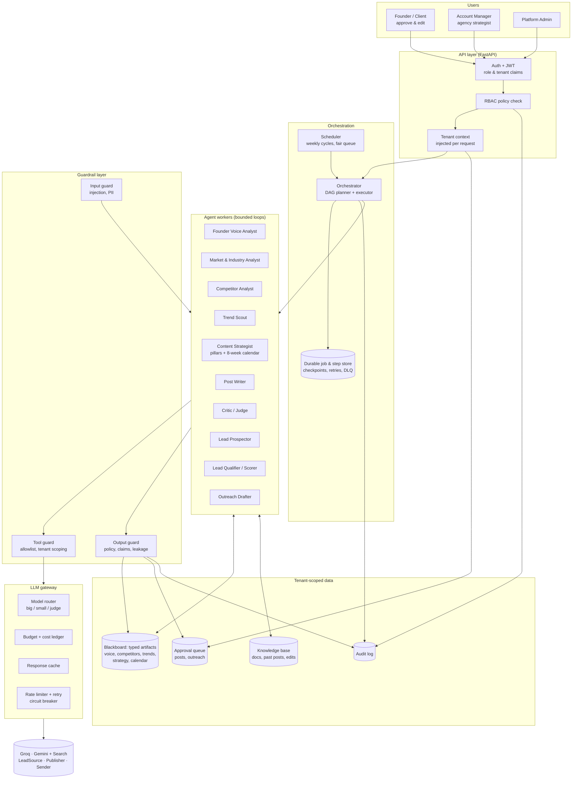
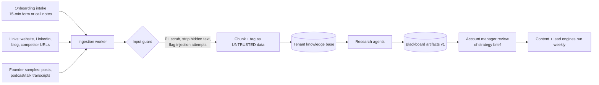
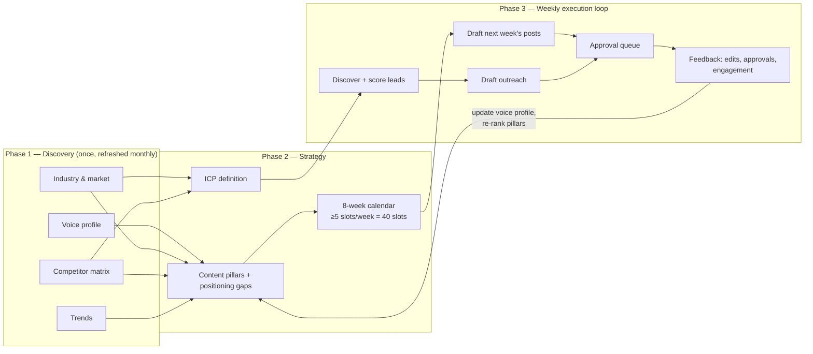
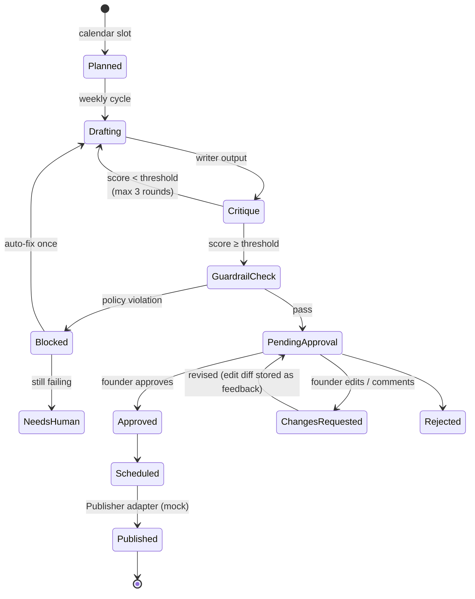
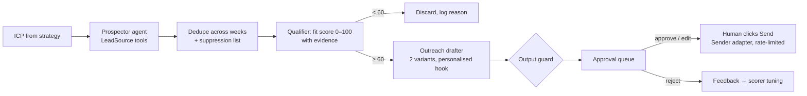

# Growth OS — Architecture & Build Plan

A done-for-you portal that runs **content marketing, personal branding and lead generation** for busy founders. Agents do the work end to end; the founder only **approves or edits** posts and outreach messages.

**Status:** plan for review. Nothing is built yet.

---

## 1. Goals and constraints

| | |
|---|---|
| Clients | 12 at launch next month, designed for 100+ |
| Client effort | Near zero: one onboarding intake, then approve/edit in a queue |
| Content KPI | ≥ 4–5 approved posts per week per client, 8-week (2-month) calendar always planned |
| Lead KPI | 10–20 qualified leads per week per client, each with a draft outreach message |
| Hard rules | Nothing is published or sent without human approval. No data leaks between clients. |
| Interviewer focus | Agentic loops, coordination, evals, cost strategy, guardrails, RBAC, tenant isolation, stress testing |

**Assumptions (change any of these before we build):**
- LLM provider is **Groq** (`openai/gpt-oss-120b` in `.env`) for reasoning and writing. The `GOOGLE_API_KEY` is used for **Gemini with Google Search grounding** for live web research, and as an **independent judge model** in evals (a different model family than the writer reduces self-grading bias).
- Real LinkedIn posting and real email sending are **out of scope**: they sit behind `Publisher` / `Sender` adapters with mock implementations. The approval flow, state machines and audit trail are fully real.
- Lead discovery uses a `LeadSource` adapter. The prototype ships a seeded prospect dataset (deterministic for demos/tests) plus web-search discovery. Apollo / Sales Navigator / Clay plug in at the same interface in production.
- Stack: **Python 3.13, FastAPI, SQLAlchemy, Pydantic v2, SQLite for local dev (Postgres + Row-Level Security in prod), pytest**. UI is server-rendered (Jinja + HTMX), no JS build step.

---

## 2. System architecture



**Design choices and why**

| Choice | Why |
|---|---|
| **Workflow-first, agents inside nodes.** The overall pipeline is a fixed DAG; each node is an agent with a bounded tool loop. | Predictable cost and ordering for a long-horizon (8-week) process; autonomy only where it adds value (research, writing, prospecting). Follows "use workflows where you can, agents where you must". |
| **Blackboard of typed artifacts** (Pydantic schemas, versioned) as the only channel between agents | Agents never pass free text to each other. Every hand-off is validated, inspectable, cacheable and replayable. |
| **Durable job store with step checkpoints** | Runs survive crashes and rate limits; a failed step resumes without redoing earlier paid LLM calls. |
| **Single LLM gateway** | One place for routing, budgets, caching, retries, cost ledger, tracing. Agents can't call a model directly. |
| **Tenant context injected by the server, never by the LLM** | The model cannot choose which client's data it touches. |

---

## 3. How input flows (onboarding → knowledge)



**Intake fields (one-time, the only thing the founder fills):** company + offerings, target customers (if known), 3–5 known competitors, goals (brand vs pipeline), topics to own, topics to avoid, tone sliders (formal↔casual, bold↔measured), compliance constraints (e.g. regulated industry), posting days, writing samples. Anything missing is inferred by research agents and flagged for the account manager to confirm.

---

## 4. End-to-end flows

### 4.1 Long-horizon orchestration (per client)



Phase 1 nodes run **in parallel**; Phase 2 waits on them (DAG dependencies). Phase 3 is a **weekly cycle** triggered by the scheduler: refresh trends (cheap), draft the coming week from the calendar, top up leads to the weekly target, then re-plan the calendar's tail so 8 weeks are always planned.

### 4.2 Content flow (with human approval)



The founder sees a **preview** that looks like the real LinkedIn post (name, avatar, text, line breaks, "...see more" fold), the reason it was written (pillar, trend, sources), and its quality score. Actions: **Approve · Edit & approve · Request changes · Reject**. Illegal transitions (e.g. `Drafting → Published`) are rejected by the state machine in code, not by the prompt.

### 4.3 Lead flow (with human approval)



Agents **have no send tool**. Sending is a separate API endpoint that only a human with the right role can call, and only on an approved message.

---

## 5. Agentic loops

Every agent runs on one shared runtime (`agents/runtime/loop.py`):

```
run(agent, task, tenant_ctx):
  budget = Budget(max_steps, max_tokens, max_usd, deadline)
  messages = [system(agent.role, policy), context(blackboard_summary), task]
  for step in 1..max_steps:
      check cancel flag, budget        -> stop with partial + reason
      resp = gateway.call(messages, tools=agent.allowed_tools, model=router(agent))
      if resp.tool_calls:
          for call in resp.tool_calls:
              args  = validate(call, schema)          # pydantic
              guard = tool_guard(agent, call, tenant_ctx)   # allowlist, scope, rate
              obs   = execute(call, timeout) wrapped as <untrusted_data>
              messages += obs
      else:
          out = parse(resp, agent.output_schema)
          if invalid: repair prompt (max 2) else return out
      checkpoint(step, messages_digest, cost)        # resumable
  return partial result + "budget_exhausted"
```

Patterns used, and where:

| Pattern | Used by | Purpose |
|---|---|---|
| **Tool-using loop (ReAct style)** | Research agents, Prospector | Search, read, extract with citations |
| **Generator ↔ critic loop** | Writer + Critic, Outreach + Critic | Rubric-scored revision, early exit when score ≥ threshold, max 3 rounds |
| **Plan-and-execute** | Orchestrator | Builds the DAG for a client, then executes ready nodes |
| **Fan-out / fan-in** | Weekly drafting (one task per slot), research phase | Parallelism with concurrency caps |
| **Reflection from human feedback** | Voice profile updater | Diff between draft and founder's edit → learned style rules ("never uses emojis", "shorter hooks") |

**Long-horizon reliability:** step checkpoints, idempotency keys per node, retries with exponential backoff + jitter on 429/5xx, circuit breaker per provider, dead-letter queue surfaced to the account manager, and **context compaction** (agents get summaries of artifacts, not raw transcripts, so prompts stay small as history grows).

---

## 6. Coordination

- **Orchestrator** owns the DAG per client: nodes, dependencies, status, attempts, outputs (artifact ids).
- **Blackboard** holds typed, versioned artifacts. A node declares what it reads and writes; changing an upstream artifact (e.g. new trends) marks dependent nodes stale, so only those re-run.
- **Scheduler** runs a **fair queue across tenants**: per-tenant concurrency cap + global cap matched to Groq rate limits, so one big client can't starve the other 11.
- **Human gates** are DAG nodes too (`strategy_review`, approvals). The run parks there and resumes when the human acts.
- **Traceability:** every node, LLM call and tool call has a trace id, tenant id, cost and latency, viewable in the ops console.

---

## 7. Guardrails (defence in depth)

| Layer | Checks | Enforced in |
|---|---|---|
| **Input** | Prompt-injection heuristics + classifier on scraped/uploaded content, hidden-text stripping, PII redaction, size limits. Fetched content is wrapped as untrusted data and never treated as instructions. | Ingestion + tool outputs |
| **Tool** | Per-agent tool allowlist, argument schema validation, tenant id injected server-side, domain allowlist for fetching, rate limits, **no send/publish tools for agents** | Runtime before execution |
| **Output** | Schema validity, brand policy (banned topics, tone), **unsupported claims** (numbers/stats must cite a source in the KB), competitor disparagement, toxicity, compliance disclaimers per tenant, **cross-tenant leakage** (no other client's names/terms), duplicate/near-duplicate of past posts, outreach PII + spam signals, length/format for LinkedIn | After generation, before queue |
| **Process** | Mandatory human approval, state machines that reject illegal transitions, outreach send caps per day, kill switch per tenant, full audit log | API + DB |
| **Cost** | Per-run and per-tenant monthly budgets with hard stop | LLM gateway |

Mapped to the OWASP LLM Top 10: prompt injection (LLM01), sensitive data disclosure (LLM02), improper output handling (LLM05), excessive agency (LLM06), system prompt leakage (LLM07), unbounded consumption (LLM10).

---

## 8. Security: RBAC and tenant isolation

**Roles**

| Role | Scope | Can |
|---|---|---|
| `platform_admin` | All tenants | Manage tenants, users, budgets, kill switch, view all traces |
| `account_manager` | Assigned tenants only | Run/re-run agents, review strategy, edit drafts, view costs |
| `client_owner` (founder) | Own tenant | Approve/edit/reject posts and outreach, send approved outreach, view calendar & KPIs |
| `client_viewer` | Own tenant | Read-only |

Permissions are checked by a `require(permission)` dependency on every route, from a single policy table (deny by default).

**Tenant isolation, layered:**
1. JWT carries `tenant_id(s)`; a request-scoped `TenantContext` is set from it.
2. All data access goes through a repository that **always** filters by `tenant_id` (no raw queries in routes).
3. Prod: **Postgres Row-Level Security** policies on every tenant table as a second wall.
4. Caches, knowledge-base chunks and LLM cache keys are namespaced by tenant.
5. Agents receive tenant context from the server; tool args never include tenant ids.
6. Output guard checks for cross-tenant leakage.
7. Tests: an automated suite tries to read/write every resource across tenants and must get 404/403.

---

## 9. Evals

Three layers plus business KPIs.

**1. Offline regression suite (runs in CI, `pytest -m eval`)**
- Golden datasets per agent: 2 fully specified demo clients + edge cases (regulated industry, thin founder samples, injection inside a scraped page).
- **Deterministic checks:** schema valid, calendar covers 8 weeks at ≥5/week, pillar balance, post length, no banned phrases, no uncited stats, lead fields complete, no duplicate leads.
- **LLM-as-judge (Gemini, different family than the writer):** rubric 1–5 on voice match, specificity, hook strength, insight vs generic, CTA fit; outreach on personalisation and relevance. Judge prompts calibrated against a small hand-labelled set; agreement reported.
- **Red-team set:** injection pages, requests to defame competitors, cross-tenant probes. Must be blocked 100%.
- Release gate: no metric drops more than a set threshold vs the last baseline.

**2. Online evals (every production output)**
- Critic score attached to every draft before it reaches the founder.
- Founder signals: approval rate, **edit distance** between draft and approved text (main quality proxy), rejection reasons, time-to-approve.
- Leads: approval rate of outreach, reply rate (when connected).

**3. Business KPIs (per client dashboard)**

| KPI | Target |
|---|---|
| Approved posts / week | ≥ 4–5 |
| Calendar horizon | 8 weeks always planned |
| Qualified leads / week | 10–20 |
| First-pass approval rate | ≥ 70% (rising over time) |
| Mean edit distance | falling week over week |
| Cost per approved post / per qualified lead | tracked, under budget |

**4. Stress & performance test** (`loadtest/`)
- Simulate 12 and 100 tenants running weekly cycles concurrently with an LLM mock that injects latency and 429 errors.
- Measure throughput, p50/p95 step latency, queue wait, fairness across tenants, retry counts, cost, and **zero cross-tenant reads**.
- Also an API load test on the approval endpoints.

---

## 10. Cost strategy

| Lever | How |
|---|---|
| **Model routing** | Big model (`gpt-oss-120b`) for strategy and writing; small fast model for classification, guardrails, scoring, extraction; judge model only in evals and critic |
| **Do expensive work rarely** | Discovery once + monthly refresh; trends weekly; drafting only for next week |
| **Cache** | Research artifacts reused across nodes; identical-prompt cache keyed per tenant; stable prompt prefixes |
| **Early exit** | Critic loop stops at threshold; most drafts should pass in 1–2 rounds |
| **Small contexts** | Agents read artifact summaries, not raw documents |
| **Budgets** | Per-run token/$ caps; per-tenant monthly cap with alert at 80% and hard stop at 100% |
| **Ledger** | Every call records model, tokens, $ → cost per client, per agent, per approved post, per lead in the ops console |

Rough sizing to verify once built: discovery ≈ 300k tokens/client once; weekly cycle ≈ 150k tokens/client. At Groq's per-token prices this is on the order of a few dollars per client per month. The ledger will report the real number.

---

## 11. Features (what you'll see)

**Client portal (founder)**
- Approval inbox: post previews and outreach drafts, approve / edit / request changes / reject
- Content calendar (8 weeks), with status per slot
- Leads list with fit score, evidence and draft message; send approved messages
- Weekly KPI summary

**Ops console (account manager / admin)**
- Client list with health: posts/week, leads/week, approval rate, budget used
- Onboarding intake and strategy brief review (voice profile, competitor matrix, trends, pillars)
- Run viewer: DAG status per client, each step's trace, tool calls, cost, retries, guardrail hits
- Eval dashboard and guardrail incident log
- Budget controls and per-tenant kill switch

---

## 12. Repository layout

```
growthos/
  app/
    main.py
    api/            routes: auth, tenants, onboarding, content, leads, approvals, runs, admin
    core/           config, security (JWT), rbac policy, tenant context
    db/             models, tenant-scoped repositories, migrations, seed (12 clients)
    llm/            gateway, model router, cost ledger, cache, rate limiter, providers (groq, gemini, mock)
    agents/
      runtime/      loop, tools registry, budget, structured output, checkpoints
      orchestrator/ DAG templates, executor, scheduler, fair queue
      research/     voice, market, competitors, trends
      strategy/     strategist, calendar, icp
      content/      writer, critic
      leads/        prospector, qualifier, outreach
    guardrails/     input, tool, output, policies
    adapters/       lead_source, publisher, sender (mock + interfaces)
    web/            Jinja + HTMX templates for client portal and ops console
  evals/            datasets, judges, run_evals.py, baseline.json
  loadtest/         stress.py (multi-tenant simulation)
  tests/            unit, rbac, tenancy isolation, guardrails, state machines, runtime
  docs/             PLAN.md, ARCHITECTURE.md, DECISIONS.md
```

---

## 13. Build milestones

| # | Milestone | Done when |
|---|---|---|
| 1 | Foundations: config, DB models, auth, RBAC, tenant context, audit log, seed 12 tenants | Isolation + RBAC tests pass |
| 2 | LLM gateway: Groq + Gemini + mock, router, budgets, ledger, retries, cache | Unit tests with mock provider |
| 3 | Agent runtime: bounded loop, tools, structured output + repair, checkpoints | Runtime tests (budget stop, resume, invalid JSON repair) |
| 4 | Guardrails: input/tool/output/process | Red-team tests blocked |
| 5 | Research + strategy agents, orchestrator DAG, 8-week calendar | Demo client gets full strategy brief |
| 6 | Content engine: writer ↔ critic, approval state machine, preview | ≥5 drafts/week generated and gated |
| 7 | Lead engine: prospector, qualifier, outreach, send gate | 10–20 scored leads/week with drafts |
| 8 | UI: client portal + ops console | End-to-end demo for 2 clients |
| 9 | Evals + KPI dashboard + stress test | Reports generated, numbers in README |
| 10 | Docs: README, architecture, decisions, how to run | Repo ready to share |

Each milestone is a separate commit; tests run with the mock LLM so the suite is free and deterministic, with an opt-in live run against Groq/Gemini.

---

## 14. Open decisions (defaults in bold)

1. UI: **FastAPI + Jinja/HTMX** (fast, no build) vs a React/Next.js frontend.
2. Web research: **Gemini with Google Search grounding** vs only seeded/cached research data.
3. Leads source: **seeded prospect dataset + web search** vs a real provider API (needs a key).
4. Persistence: **SQLite locally, Postgres RLS documented and migration-ready** vs Postgres via Docker from day one.
