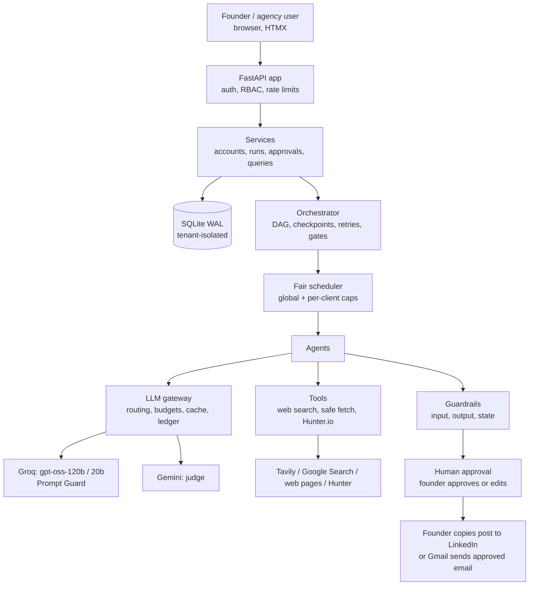
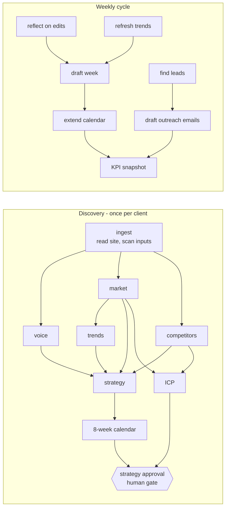
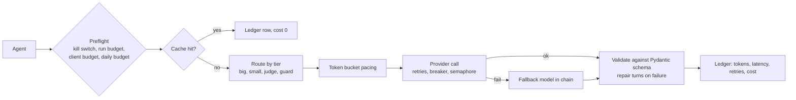

# Architecture

Growth OS is a **fixed workflow with real agents inside each step**. The order of work, the checkpoints, the budgets and the human approvals are deterministic code. The agents decide how to research, what to search and how to write. Everything a model produces is checked by code before a human sees it.

## 1. System overview

## 2. The two workflows (DAGs)

Each node is a checkpoint row in the database. A succeeded node is never re-run: after a crash or a retry the run resumes from the first unfinished node. A failed node blocks only its dependents. Non-retryable errors (missing key, bad credentials, exhausted quota) fail fast with the fix shown to the user.

## 3. The agent loops

| Loop | What it does | Bounds |
|---|---|---|
| Research agents (market, competitors, trends) | choose their own searches, open pages, then submit a typed result | step cap, tool-call cap, URL allowlist, budget check before every call |
| Writer and critic | draft, score with a different model family, revise with the critic's must-fix list | pass score 4.0, max 3 rounds, early exit |
| Guard auto-fix | if a draft breaks a rule, one rewrite with the violations as instructions | one attempt, never for critical violations |
| Calendar planner | proposes weeks, code validates (5+ posts on distinct days, pillar mix, unique topics), violations fed back | up to 3 repairs |
| Lead discovery | plan queries, search (code), extract companies, verify against results, attach Hunter contacts, score | up to 3 rounds, everything seen is excluded |
| Learning loop | founder edits and rejections become durable voice rules in the next weekly cycle | max 15 rules |

Single-call steps (not loops): voice profile, strategy, ICP, lead scoring, outreach drafting.

## 4. A model call, in detail

## 5. Data and tenant isolation

- Every tenant-owned table carries `tenant_id`. A SQLAlchemy `do_orm_execute` interceptor adds the filter to every query and **refuses** queries with no tenant scope or with shapes it cannot filter. A `before_flush` hook blocks cross-tenant writes and tenant changes.
- Tenant scope lives in a `contextvar` set by the server, never by a model: tool arguments containing a tenant id are rejected.
- Foreign tenants return 404, not 403, so ids cannot be probed. Postgres RLS migration is included for production.
- SQLite runs WAL, `synchronous=NORMAL`, `busy_timeout=30000`; writes use `BEGIN IMMEDIATE`; no transaction is ever held across a model call.

## 6. Security model

- Roles: platform admin, account manager, founder (`client_owner`), read-only viewer. One deny-by-default permission table (`app/core/security.py`); a role grants *what*, membership grants *where*.
- Founders can start runs and approve their own strategy; run internals (traces, costs by agent) are agency-only. Approving, sending and marking posted are founder-only.
- Passwords: bcrypt. Sessions: signed JWT in an HttpOnly, SameSite=Lax cookie. Rate limits on login, signup and run starts. Security headers on every response.
- Secrets live in environment variables. Gmail refresh tokens are Fernet-encrypted at rest.

## 7. Real vs not real

| Piece | Status |
|---|---|
| Groq models, Gemini judge, Prompt Guard | real |
| Web search | real (Tavily, Google Search grounding); fails loudly if neither works |
| Hunter.io, Gmail OAuth | real code, tested against mock HTTP; live Gmail send not yet exercised |
| LinkedIn publishing | not integrated by design: founder copies approved posts and marks them posted |
| Fixtures and mock models | tests, load test and a labelled local demo only; refused in production |
