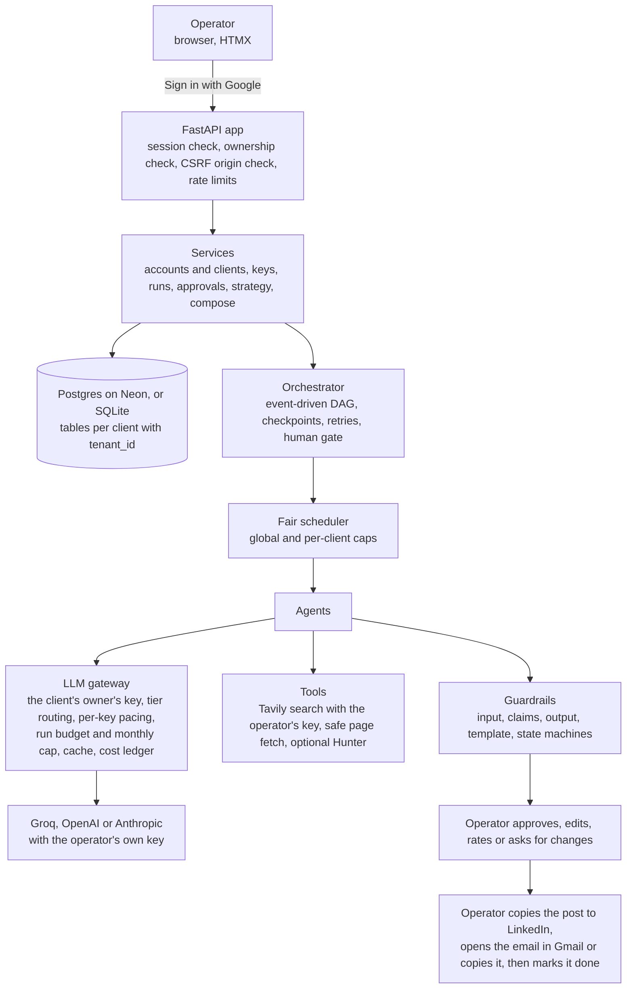
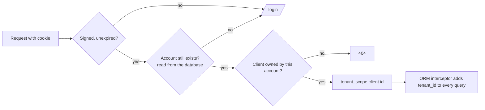
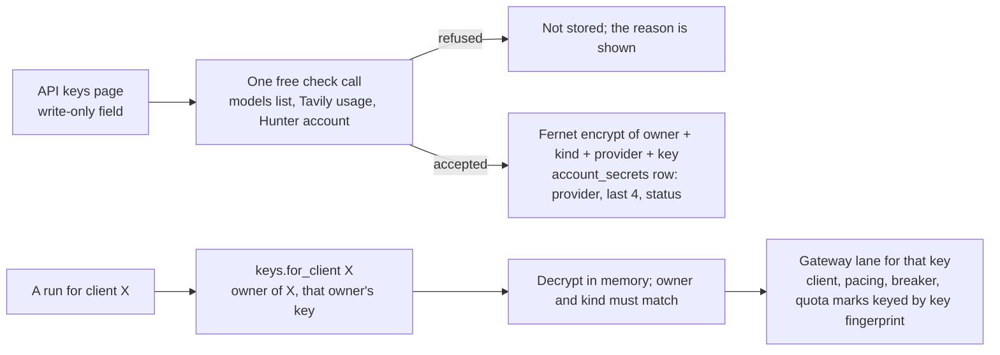
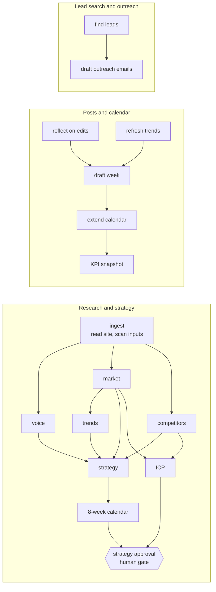
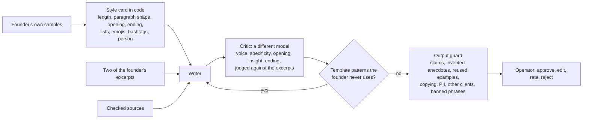
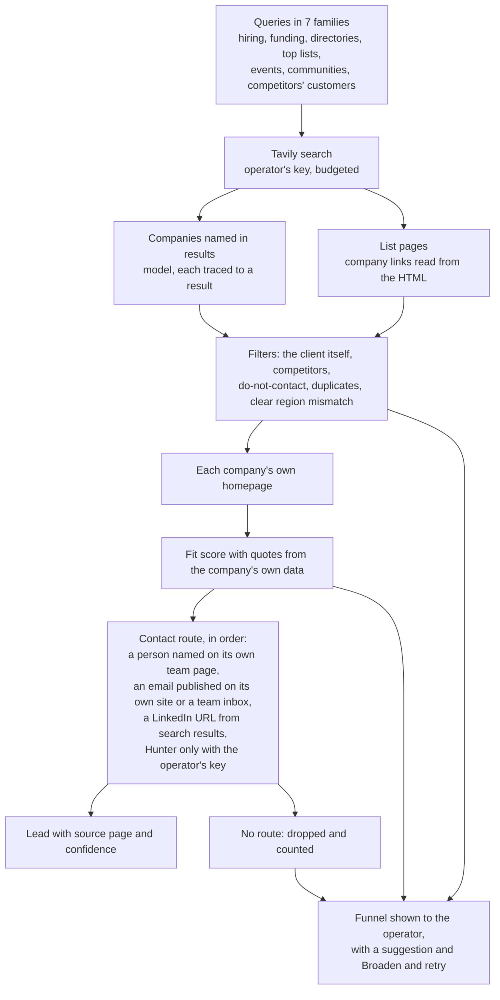
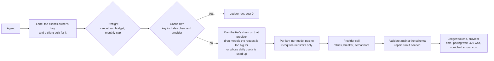

# Architecture

Growth OS is a **fixed workflow with agents inside each step**, run by one operator for the founders they work for.
The order of work, the checkpoints, the budgets and the human approvals are deterministic code. The agents decide what
to search, what to read and how to write. Everything a model produces is checked by code before the operator sees it.

## 1. System overview

## 2. Accounts, clients and isolation

- **One account per person**, created on first Google sign-in and identified by Google's `sub`. An account owns any
  number of **clients** (table `tenants`, column `owner_user_id`). There are no roles.
- **The one access rule:** a client route answers only if the client belongs to the signed-in account; otherwise 404,
  so ids cannot be probed (`app/api/deps.py:tenant_or_404`). Services check again (`app/core/security.py:authorize`).
- **Sessions:** a signed JWT in an HttpOnly, SameSite=Lax cookie that carries only the user id. Every request re-reads
  the account and the clients it owns, so a deleted account or client is gone on the next click.
- **Inside a client:** every client-owned table carries `tenant_id`. A SQLAlchemy `do_orm_execute` interceptor adds the
  filter to every query and refuses queries with no scope or a shape it cannot filter; `before_flush` blocks writes to
  another client. The scope is a `contextvar` set by server code, never by a model.
- **Proof:** `evals/isolation.py` finds every client route in the app automatically and calls each one as another
  account and signed out, tries forged, unsigned, tampered, expired and stale sessions, scans every page the other
  account can open, and checks API keys never appear anywhere. A mutation test breaks the rules on purpose five ways
  and must notice each one.

## 3. Bring your own keys

- `app/services/keys.py` is the only module that reads or writes the ciphertext (a test greps for any other).
- Production refuses to start without a valid `ENCRYPTION_KEY`; `ENCRYPTION_KEYS` (newest first) rotates keys.
- Keys are never sent to the browser, logged, or stored in error text: provider errors are scrubbed of the key and of
  anything key-shaped, and a log filter does the same for every log line.
- A key the provider refuses during a run stops the run at once with "replace the key" and marks the key "not
  working"; it is never retried.

## 4. The workflows (DAGs)

The operator starts three workflows per client from separate buttons. **Research and strategy** runs once (and again
on request). **Posts and calendar** and **lead search and outreach** are independent weekly runs that may overlap.

- **Checkpoints.** Each node is a row. A succeeded node never re-runs; after a crash or a retry the run resumes from
  the first unfinished node. A failed node blocks only its dependents.
- **Honest outcomes.** A run ends `succeeded` only if every target was met; otherwise `succeeded_with_shortfall` with
  the reasons, or `failed` with the fix. Missing or refused keys, and exhausted quotas, fail fast.

## 5. Posts: the founder's voice, held by code

| Loop | Bounds |
|---|---|
| Research: the model picks searches and pages from compact observations; code runs them; one extraction reads the evidence; every claim is checked against its page | 3 steps, 6-7 pages |
| Writer and critic, then guard auto-fix, then fresh redrafts told why the last fell short | 2 rounds, 2 fixes, 3 attempts, stop when not improving, 7-minute budget |
| Calendar planner: chunks in parallel, validated in code (posts per week, pillar mix, unique topics) | 3 repairs |
| Lead engine (below) | 3 rounds, 24 searches and 60 page reads per run |
| Learning: operator edits and rejections become voice rules for the next run | 15 rules |

## 6. Leads: found on the open web, reachable, explained

Email addresses are never guessed or built from name patterns. linkedin.com is never fetched; only URLs that a search
returned are used. Outreach drafts are short, evidence-based, carry an opt-out line and never name the operator's
business; the operator opens them in Gmail or copies them, sends them, and marks them sent.

## 7. A model call

| Tier | Groq | OpenAI | Anthropic | Used for |
|---|---|---|---|---|
| big | gpt-oss-120b, then qwen3.8-27b | gpt-6.1-sol | claude-sonnet-5-5 | posts, outreach, strategy, calendar, voice |
| research, small | gpt-oss-20b, qwen3.8-27b, gpt-oss-120b | gpt-6-luna | claude-haiku-5-5 | research decisions, queries, scoring, people on team pages |
| extract | gpt-oss-120b, qwen3.8-27b, gpt-oss-20b | gpt-6.1-terra | claude-haiku-5-5 | one extraction from an evidence pack |
| judge | qwen3.8-27b, gpt-oss-120b | gpt-6.1-terra | claude-haiku-5-5 | the critic (never the writer's model) |
| guard | Prompt Guard 86M, 22M | gpt-6-luna, asked in words | claude-haiku-5-5, asked in words | prompt-injection check |

The table lives in one place (`PROVIDER_ROUTES` in `app/core/config.py`) and can be overridden for development with
`MODEL_ROUTES_JSON`. Groq's free tier allows 8,000 tokens a minute per model; the gateway paces per key and per model
and spills to the next model in the tier when the first is busy.

## 8. Real vs not real

| Piece | Status |
|---|---|
| Groq adapter | real, measured on live runs |
| OpenAI adapter | protocol verified against an OpenAI-compatible endpoint (Groq's), not against OpenAI; contract-tested with mocks |
| Anthropic adapter | contract-tested with the official SDK over a mock transport; not run against Anthropic's API |
| Web search (Tavily), page fetch, list mining, contact routes | real, measured on live runs |
| Hunter.io | optional; contract-tested with mocks; not needed for leads |
| Google sign-in | real code, tested against a fake Google that signs real RS256 tokens; verified live only once the operator signs in |
| Sending email, publishing posts | not done by the system: the operator does it and marks it done |
| Fixtures and mock models | tests and the labelled local demo only; production refuses to load them |
