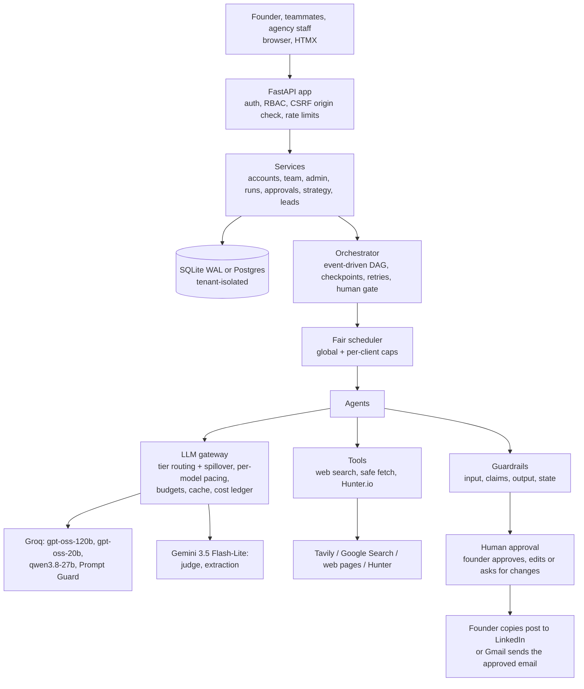
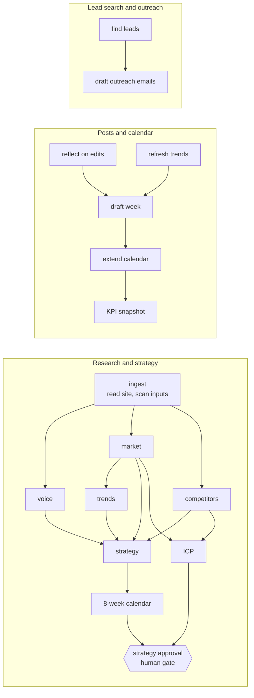
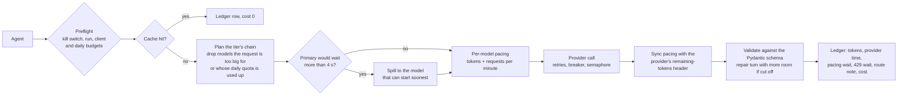

# Architecture

Growth OS is a **fixed workflow with real agents inside each step**. The order of work, the checkpoints, the budgets and the human approvals are deterministic code. The agents decide what to search, what to read and how to write. Everything a model produces is checked by code before a human sees it.

## 1. System overview

## 2. The workflows (DAGs)

Founders run three workflows from separate buttons. **Research and strategy** runs once (and again on request). **Posts and calendar** and **lead search and outreach** are independent weekly runs that may overlap. The all-in-one `weekly` run is kept for the agency console.

- **Checkpoints.** Each node is a row. A succeeded node never re-runs: after a crash or a retry, the run resumes from the first unfinished node. A failed node blocks only its dependents.
- **Event-driven.** A node starts the moment its own dependencies succeed (trends does not wait for competitors).
- **Honest outcomes.** A run ends `succeeded` only if every KPI target was met, otherwise `succeeded_with_shortfall` with the reasons (for example "4 of 5 posts ready; 1 draft stayed below the editor's bar"), or `failed` with the fix. Non-retryable errors (missing key, bad credentials, exhausted quota) fail fast.
- **Suggest changes.** On the strategy page the founder writes what to add, change or remove; only the strategy and calendar (and/or the ICP) are redone with that note, weeks that already hold drafted posts are kept, and the run waits for approval again.

## 3. The agent loops

| Loop | What it does | Bounds |
|---|---|---|
| Research (market, competitors, trends) | **decide-act loop**: the model sees compact observations (titles, URLs, snippets, page openings) and chooses searches and pages; code runs them in parallel; one structured extraction reads the evidence | 3 steps, 4 searches and 4 reads per step, 6-7 pages in all, URL allowlist |
| Claim verification (code) | every fact, competitor and trend is checked against the text of the page it cites; outdated figures are labelled | unsupported claims are flagged, never shown as facts |
| Writer and critic | draft, score with a different model family (anchored rubric), revise | pass score 4.0, 2 editor rounds per attempt |
| Guard auto-fix | rewrite a draft that broke a rule, with the violations as instructions | 2 rewrites, never for critical violations |
| Redraft loop | fresh drafts for a slot until one passes guardrails and the editor's bar | 3 attempts, stop when an attempt does not improve, 270 s time budget |
| Calendar planner | proposes 4-week chunks in parallel; code validates (posts per week on distinct days, pillar mix, unique topics) | 3 repairs per chunk |
| Lead engine | plan queries → search (code) → extract companies → verify against results → score → contacts for qualified companies only | 3 rounds, evidence must quote the prospect's data, Hunter quota respected |
| Learning loop | founder edits and rejections become durable voice rules in the next run | 15 rules |

Single calls: voice profile, strategy, ICP, lead scoring, outreach drafting.

## 4. A model call, in detail

| Tier | Default chain (first model leads; set with `ROUTE_*`) | Used for |
|---|---|---|
| big | gpt-oss-120b → qwen3.8-27b | posts, outreach, strategy, calendar, voice |
| research, small | gpt-oss-20b → qwen3.8-27b → Gemini Flash-Lite | research decisions, query planning, scoring, reflection |
| extract | Gemini Flash-Lite → gpt-oss-120b → qwen3.8-27b | one extraction from a large evidence pack |
| judge | Gemini Flash-Lite → qwen3.8-27b | the critic (a different family than the writer) |
| guard | Prompt Guard 86M → 22M | prompt-injection classifier |

Free-tier limits are per model (Groq: 8,000 tokens and 30 requests per minute, about 200,000 tokens and 1,000 requests per day), so spreading tiers across models is what makes the runs fast without breaking any limit. Paid plans raise those limits; the routing does not change.

## 5. Data and tenant isolation

- Every tenant-owned table carries `tenant_id`. A SQLAlchemy `do_orm_execute` interceptor adds the filter to every query and **refuses** queries with no tenant scope or shapes it cannot filter. A `before_flush` hook blocks cross-tenant writes and tenant changes.
- Tenant scope lives in a `contextvar` set by the server, never by a model: tool arguments containing a tenant id are rejected.
- Foreign workspaces return 404, not 403, so ids cannot be probed.
- SQLite runs WAL with `BEGIN IMMEDIATE` writes; Postgres is supported (any hosted `postgres://` URL), the test suite runs on both, and a row lock guards the email-send claim. A Postgres RLS migration is included.
- Ledgers: `llm_calls` (every model call, with waits), `external_calls` (search credits, contact lookups, sends), `audit_log` (per workspace) and `platform_audit` (admin actions).

## 6. Security model

- **Roles:** platform admin, account manager, founder (`client_owner`), read-only viewer. One deny-by-default permission table (`app/core/security.py`) says *what*; workspace membership says *where*. A `GRANTABLE` table says which roles a role may hand out (founders: viewer and owner; admin: account manager; nobody grants above their own).
- **Team page:** a founder adds teammates with an email, password and role, changes roles, resets passwords, deactivates or removes them. The last active owner can never be removed or demoted. **Admin data view:** read-only users, workspaces, memberships, runs, spend and audit with search; creates account managers and assigns clients. No password hashes, tokens or keys are ever selected.
- **Sessions:** a signed JWT in an HttpOnly, SameSite=Lax cookie, **re-checked against the database on every request**, so deactivation, role changes and removal apply on the next click. Cross-site writes are refused by an Origin check. Rate limits on login, signup and run starts. bcrypt passwords, 10+ characters.
- **Approvals:** founders approve, send and mark posted; account managers can run, draft and edit but not approve or send on a founder's behalf. Every write a viewer attempts returns 403 with a page naming the missing permission.
- **Secrets** live in environment variables. Gmail refresh tokens are Fernet-encrypted at rest.

## 7. Real vs not real

| Piece | Status |
|---|---|
| Groq models, Gemini judge and extraction, Prompt Guard | real, measured on live runs |
| Web search | real (Tavily first, Gemini grounding as fallback); fails loudly if neither works |
| Hunter.io | real, used on live runs within the monthly quota |
| Gmail OAuth sending | real code, tested against mock HTTP; not yet sent live (needs the founder's own OAuth consent in a browser) |
| LinkedIn publishing | not integrated by design: the founder copies approved posts and marks them posted |
| Fixtures and mock models | tests, stress test, evals and a labelled local demo only; refused in production |
