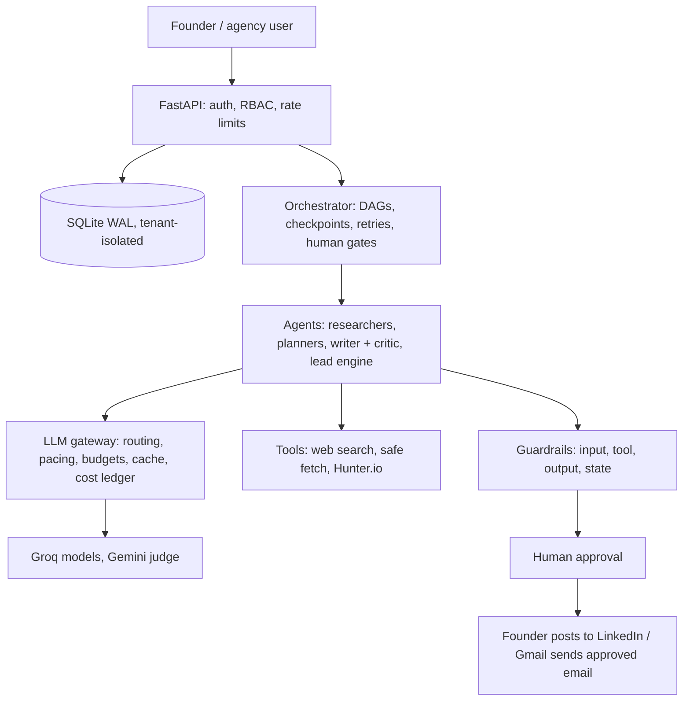

# Growth OS: reviewer guide

A done-for-you growth portal for busy founders: content marketing, personal branding and lead generation. Agents research the founder's market and competitors, plan an 8-week LinkedIn calendar, write at least 5 posts a week in the founder's voice, find 10 to 20 leads a week and draft outreach emails. **A human approves everything before it is posted or sent.** Designed for 12 clients onboarding next month, with a path to 100+.

Deeper documents: [Architecture](ARCHITECTURE.md) · [Evals and guardrails](EVALS_AND_GUARDRAILS.md) · [Cost and run time](ECONOMICS.md) · [Known issues and handoff](../HANDOFF.md)

**Status in one line.** Built and tested (161 automated tests passing); research, strategy, drafting and lead discovery were run end to end on real providers (Groq, Gemini, Tavily, Hunter.io). Not yet exercised live: Gmail sending. Run time is slow today because of free-tier model limits (section 4).

## 1. Requirements and where they live

| Requirement | Where |
|---|---|
| Agentic loops | `app/agents/runtime/loop.py` (bounded tool loop); writer and critic in `app/agents/content/`; lead engine in `app/agents/leads/` |
| Coordination and long-horizon planning | `app/agents/orchestrator/` (DAGs, checkpoints, retries, human gate, fair scheduler); 8-week calendar planner validated by code |
| Founder voice, competitors, trends, strategy | `app/agents/research/`, `app/agents/strategy/` |
| Leads and templated outreach with human edit | `app/agents/leads/`, `app/services/approvals.py` |
| Content preview and final approval | portal UI, `app/web/` |
| Evals, guardrails | `evals/`, `app/guardrails/` |
| Cost strategy | `app/llm/gateway.py`, section 4 |
| RBAC and tenant isolation | `app/core/security.py`, `app/db/session.py` |
| Stress and performance testing | `loadtest/` |
| Production practice | Alembic migrations, budgets, rate limits, secrets in environment variables, honest failure handling, no demo data in production |

## 2. Architecture



**Design choice: a fixed workflow with real agents inside each step.** Order, checkpoints, budgets and approvals are deterministic code, so cost is predictable, runs resume after a crash, and every gate is testable. Agents decide how to research and write.

| Workflow | Steps | Runs |
|---|---|---|
| Discovery | ingest, voice, market, competitors, trends, strategy, ICP, 8-week calendar, then **human approval gate** | once per client |
| Content and calendar | learn from founder edits, refresh trends, draft the week's posts, extend the calendar | weekly, own button |
| Leads | search for companies, verify, attach Hunter.io contacts, score, draft outreach emails | weekly, own button |

Content and lead runs are independent: separate buttons, no shared steps, and they may run at the same time. Each step is a database checkpoint; a succeeded step never re-runs, and a failed step blocks only its dependents.

| Agent loop | What it does | Bounds |
|---|---|---|
| Research agents | choose their own searches, open pages, return a typed result | step and tool-call caps, URL allowlist, budget check per call |
| Writer and critic | draft, score with a different model family, revise | pass score 4.0, 3 rounds, early exit |
| Guard auto-fix | rewrite a draft that broke a rule | two attempts, never for critical violations |
| Calendar planner | propose weeks, code validates, violations fed back | 3 repairs |
| Lead engine | plan queries, search (code), extract, verify against results, attach contacts, score | 3 rounds |
| Learning loop | founder edits become durable voice rules | 15 rules |

## 3. Real data only

Web search (Tavily or Google grounding), an SSRF-safe page fetcher, Hunter.io contacts and Gmail OAuth are real integrations. If a key is missing or a provider fails, the step stops and shows the fix; nothing is replaced by canned output. Mock models and fictional data exist only in tests and a labelled local demo, and production refuses to start with them.

## 4. Cost, latency and unit economics

### 4.0 Models in use

| Model | Role | Provider |
|---|---|---|
| gpt-oss-120b | strategy, post writing, company extraction (the "big" tier) | Groq |
| gpt-oss-20b | scoring, planning, extraction (the "small" tier) | Groq |
| Llama Prompt Guard 2 (86M) | prompt-injection classifier on every fetched page | Groq |
| Gemini 3.5 flash-lite | critic and judge (a different model family than the writer); Google Search grounding | Google |
| Qwen3.8-27B | judge fallback if Gemini fails | Groq |

Routing is by tier with a fallback chain, a circuit breaker and a per-model pacing bucket. The comparison with other paid models is in section 4.3.

### 4.1 Tokens and external calls per run (measured on live runs)

| Run | Model calls | Input tokens | Output tokens | Web searches | Page fetches | Hunter lookups |
|---|---|---|---|---|---|---|
| Research and strategy (once per client) | 58 | 70,032 | 9,565 | 8 | 7 | 0 |
| Content run (planning figure) | about 40 | about 50,000 | about 8,000 | 0 to 2 | 0 | 0 |
| Lead run (planning figure) | about 40 | about 50,000 | about 7,000 | about 8 | 0 | about 12 to 15 |

The research row is measured. A combined weekly run measured 83 calls, 92,439 input and 14,999 output tokens, 16 candidate companies and 11 Hunter lookups. **Splitting it into content and leads is an estimate**, because the two workflows were separated after that run. One client per month is one research run, four content runs and four lead runs: **about 470,000 input and 70,000 output tokens.** Input dominates because agents read search results. About 40% of calls are tiny safety-scanner calls on fetched pages.

### 4.2 Where the time goes today (measured, Groq free tier)

| Research and strategy step | Wall time |
|---|---|
| ingest, voice | 10 s, 2 s |
| competitors (runs in parallel) | 516 s |
| market (runs in parallel) | 228 s |
| trends (after market) | 172 s |
| ICP, strategy, calendar | 27 s, 37 s, 86 s |
| **Whole run** | **about 14 min** |
| Weekly cycle (content plus leads) | 20 to 35 min |

| Measure | Value |
|---|---|
| Average model response time | gpt-oss-120b 3.1 s, gpt-oss-20b 2.8 s, Gemini flash-lite 1.5 s, Prompt Guard 0.3 s |
| Total model response time in a whole run | about 2.5 min |
| Retries that failed outright | 0 |

**Why it is slow:** the model is not. Groq's free tier allows 8,000 tokens per minute per model and 200,000 per day per model. The big writer model used about 73,000 tokens in one research run, which needs more than 9 minutes at 8,000 per minute, so our pacing code (`TokenBucket`) makes calls wait. Groq also counts the reserved output size, not the actual output. In one test the daily cap was reached and Groq answered "429 too many requests" until the window freed. This is a provider limit, not agent logic.

### 4.3 AI-only cost on paid APIs (tokens only)

Prices are list prices per million tokens as I know them; **verify on each provider's pricing page before quoting.** Formula: `(input tokens x price_in + output tokens x price_out) / 1,000,000`.

| Model tier | $ in / out per 1M | Research run | Content run | Lead run | Per client per month | 12 clients | 100 clients | Est. time: research / weekly run |
|---|---|---|---|---|---|---|---|---|
| Groq gpt-oss-120b (current writer) | 0.15 / 0.60 | $0.016 | $0.012 | $0.012 | **$0.11** | $1.4 | $11 | 2-3 min / 3-4 min |
| Groq gpt-oss-20b (current scorer) | 0.075 / 0.30 | $0.008 | $0.006 | $0.006 | $0.06 | $0.7 | $5.6 | 2-3 min / 3-4 min |
| Gemini 3.5 flash-lite | 0.10 / 0.40 | $0.011 | $0.008 | $0.008 | $0.08 | $0.9 | $7.5 | 2-3 min / 3-4 min |
| OpenAI mini-class | 0.15 / 0.60 | $0.016 | $0.012 | $0.012 | $0.11 | $1.4 | $11 | 3-4 min / 4-5 min |
| OpenAI GPT-4o-class | 2.50 / 10.00 | $0.27 | $0.21 | $0.20 | **$1.88** | $22.5 | $187 | 4-6 min / 5-7 min |
| Claude Haiku-class | 1.00 / 5.00 | $0.12 | $0.09 | $0.09 | $0.82 | $9.8 | $82 | 3-5 min / 4-6 min |
| Claude Sonnet-class | 3.00 / 15.00 | $0.35 | $0.27 | $0.26 | **$2.46** | $29.5 | $245 | 5-8 min / 6-9 min |

**The time column is an estimate, not a measurement.** It is the number of sequential calls on the critical path (about 20 to 25 for research, 15 to 20 for a content or lead run) times typical per-call latency: about 3 s measured on Groq, 5 to 12 s assumed for larger models. With no rate limits, expect roughly 4 to 5 times faster than today.

### 4.4 Cost per single run, all-in (tokens plus every other service)

"One query" here means one run the founder starts from the UI. Assumptions (all to be verified, and the main reason to check prices): Tavily about $0.008 per credit with 1 credit per search; Hunter about $0.10 per lookup on an entry paid plan (a larger plan can bring this to about $0.04); hosting on Render Starter plus a 1 GB disk, about $7.25 a month, shared across 108 runs a month (12 clients), about $0.07 per run.

| Run | AI (Groq 120b) | Tavily | Hunter | Hosting share | **All-in on Groq** | All-in with GPT-4o-class | All-in with Claude Sonnet-class |
|---|---|---|---|---|---|---|---|
| Research and strategy (8 searches) | $0.016 | $0.064 | $0 | $0.067 | **$0.15** | $0.40 | $0.49 |
| Content run | $0.012 | $0.008 | $0 | $0.067 | **$0.09** | $0.28 | $0.35 |
| Lead run (about 8 searches, about 15 lookups) | $0.012 | $0.064 | $1.50 | $0.067 | **$1.64** | $1.83 | $1.89 |

Unit cost, all-in (including the shared hosting cost):

| Unit | Groq | GPT-4o-class | Claude Sonnet-class |
|---|---|---|---|
| Per ready post (a content run of 5 posts) | $0.02 | $0.06 | $0.07 |
| Per lead found (about 10 kept per lead run, with a contact lookup) | $0.16 | $0.18 | $0.19 |
| Per client per month (1 research + 4 content + 4 lead runs) | **$7.07** | **$8.83** | **$9.41** |
| Margin if a client pays an illustrative $500 a month | 98.6% | 98.2% | 98.1% |

The $500 price is an illustration, not a real price.

**Hunter.io is the biggest variable cost, not the AI.** Without Hunter, leads are found as companies with no contact person, and a lead run costs about $0.15.

### 4.5 Platform cost at zero users, and the projection

| Item | At 0 users | What it depends on |
|---|---|---|
| Hosting (Render) | **$0** on the free instance (database resets on redeploy); about $7.25 a month with a persistent disk | Starter instance about $7, disk about $0.25 per GB |
| AI models (Groq, Gemini) | $0 | free tier, or pay per token |
| Web search (Tavily) | $0 | free tier of 1,000 credits a month |
| Contact emails (Hunter.io) | $0 | free plan about 25 searches a month; an entry paid plan is a fixed monthly fee (assumed about $49) if you choose to buy it |
| Gmail sending, Google Cloud OAuth, GitHub | $0 | no charge for this volume |
| Domain name (optional) | about $1 a month | about $10 to $15 a year |
| **Total at 0 users** | **$0** (about $7 to $8 with a disk, about $56 if you also buy a Hunter plan up front) | |

Monthly cost projection (variable cost per client per month on the Groq mix: AI $0.11 + Tavily $0.35 + Hunter $6.00 = **$6.46**, or **$0.46** without Hunter):

| Clients | Hosting | AI on Groq | AI on GPT-4o-class | AI on Claude Sonnet-class | Tavily | Hunter | **Total (Groq)** | **Total (GPT-4o)** | **Total (Sonnet)** |
|---|---|---|---|---|---|---|---|---|---|
| 0 | $0 to $7 | $0 | $0 | $0 | $0 | $0 | **$0 to $7** | $0 to $7 | $0 to $7 |
| 1 | $7 | $0.11 | $1.88 | $2.46 | $0.35 | $6.00 | **$13.7** | $15.5 | $16.1 |
| 12 | $7 | $1.4 | $22.5 | $29.5 | $4.2 | $72 | **$85** | $106 | $113 |
| 100 | larger hosting, not priced | $11 | $187 | $245 | $35 | $600 | **$646 + hosting** | $822 + hosting | $880 + hosting |

Read this as order-of-magnitude, not a quote. Tavily and Hunter plans are sold in tiers, so real cost steps up in jumps; the free Tavily tier covers about 24 clients a month (1,000 credits at about 42 per client). At 100 clients the single worker and SQLite need replacing (Postgres, a job queue), which this table does not price.

### 4.6 How cost is controlled

| Lever | How |
|---|---|
| Tiered routing | small model for scoring and extraction, large model only for strategy and writing |
| Do expensive work once | research once per client; trends reused for 6 days |
| Budgets | per run, per client per month (80% alert, 100% stop), service-wide per day |
| Kill switch | per client, checked by the gateway, orchestrator and send gate |
| Cache and compaction | response cache; compact summaries instead of raw documents in prompts |
| Visibility | every call in the ledger; live tokens and cost on the Activity page |

## 5. Evals

**30 hand-written cases plus a 14-metric release gate.** 22 red-team cases (12 post, 3 outreach, 7 input-injection, including benign controls), 8 hand-scored drafts for judge calibration, and a pipeline eval that scores a full discovery plus weekly run for two clients against business rules and ground-truth labels. The 161 automated tests are separate (section 7).

Principle: **the model proposes, code disposes.** What code can check is checked in code. The LLM judge covers only voice and hook quality, and is itself measured.

| Eval | What it measures | Result |
|---|---|---|
| Red-team gate | the right guardrail fires on attacks; benign controls measure false positives | block recall 1.0, false positives 0.0 |
| Input-injection recall | hidden and visible prompt injection in pages and lead data | 0.8 (the miss is an obfuscated case meant for the live classifier) |
| Pipeline eval | valid 8-week calendar, 5+ posts a week, drafts reach the founder, no suppressed or competitor leads, no injected text in outputs | all pass |
| Judge calibration (live only) | critic within one point of a human, Spearman 0.6 or better | gate defined; not re-run since the refactor |
| Online signals | approval rate, first-pass approval, edit distance between draft and approved text | computed per client |
| Stress test (mock models, injected 429/5xx) | 100 clients: 200/200 runs, 0 failed steps, 0 database lock errors, 0 cross-tenant violations, about 67 s, API p95 under 400 ms | pass; proves orchestration and isolation, not provider speed |

`python -m evals.run_evals` compares every metric with `evals/baseline.json` and exits non-zero on a breach.

## 6. Guardrails (enforced in code, not prompts)

**49 individual controls: 47 deterministic code, 2 model-based** (counted from the code; the grouping is a judgment).

| Group | Count | Deterministic or model-based |
|---|---|---|
| Input (strip hidden text, regex checks, quarantine rule) | 3 | deterministic |
| Input (Llama Prompt Guard classifier) | 1 | model-based |
| Tool guards (allowlist, schema, call cap, no tenant choice, URL/SSRF) | 5 | deterministic |
| Output rules (safety 7, facts 6, originality 3, quality 3, outreach 4) | 23 | deterministic |
| Process (2 approval state machines, 7 send-gate checks) | 9 | deterministic |
| Cost and access (3 budgets, kill switch, rate limits, breaker, RBAC, tenant isolation) | 8 | deterministic |

The second model-based control is the critic, which scores voice and hook quality; it is a quality check, not a safety rule. What each layer does:

| Layer | Controls |
|---|---|
| Input | strip hidden markup and zero-width text; heuristics plus Llama Prompt Guard; visible injection quarantined, hidden injection stripped and logged |
| Untrusted data | web content wrapped in `<untrusted_data>`; canary string detects prompt leakage |
| Tools | per-agent allowlist, schema validation, call caps, models can never choose a tenant, URL allowlist, SSRF-safe fetch |
| Output: safety | cross-tenant leakage, PII, banned topics, competitor disparagement, agency name leaking into client voice |
| Output: facts | **claim-level grounding:** every figure needs a verbatim source quote and must be used for what the source says; cited research URLs must have actually been seen or the claim is dropped |
| Output: originality | near-duplicates and copying of the founder's sample posts |
| Process | state machines (nothing is approved without a human; email goes approved, sending, sent with a lock so it cannot send twice); send gate checks role, approval, verified recipient, do-not-contact list, daily cap, kill switch |
| Cost and access | budgets and kill switch; deny-by-default RBAC; tenant interceptor; foreign tenants get 404 |

**A real bug found by a live run:** a customer count ("1,100 SMB customers") was reused as a market statistic. It is now a claim-level check with a regression test. The same runs also exposed an invented "$2,000" figure and invented anecdote, which the guardrails blocked, and the agency name leaking into an email, now a high-severity rule.

## 7. Tests: 161 passing

| Area | Tests | Covers |
|---|---|---|
| Accounts and onboarding | 20 | signup validation, clean empty workspace, profile persistence, isolation, rate limits, UI flow |
| Integrations | 24 | Hunter, search fallback, safe fetch, Gmail OAuth (mock HTTP): quota, bad key, outage, retries |
| Guardrails | 19 | input, output, state machines |
| Grounding | 14 | claim checks, copied hooks, the misattribution regression |
| Gateway and agent runtime | 12 | retries, breaker, budgets, cache, repair loop, tool guard |
| Orchestration | 10 | retry, fail-fast, blocked dependents, checkpoint reuse, crash resume, fairness, budget stop |
| Send gate | 10 | unapproved, unverified, suppressed, wrong role, double click sends once, daily cap |
| Production integrity | 10 | production refuses mock and weak secrets; boots the real app on an empty database with no demo data |
| Session validity (token vs database) | 5 | wiped database, deactivation, role change and membership removal take effect immediately |
| Separate content and lead workflows | 6 | independent runs, overlap rules, refusal before research, agency name never in client voice |
| Pipeline, API security, research integrity, tenancy, evals | 31 | end-to-end cycles, RBAC matrix, cross-tenant probes, fabricated sources dropped, ORM interceptor |

## 8. Security and tenancy

Four roles (admin, account manager, founder, read-only viewer) in one deny-by-default permission table; workspace membership is a second, independent check. A SQLAlchemy interceptor adds the tenant filter to every query and refuses unscoped ones; writes are checked before flush. Passwords use bcrypt, sessions are signed cookies, Gmail tokens are encrypted at rest, secrets live only in environment variables, and foreign workspaces return 404.

## 9. Known limitations and next steps

| Limitation | Plan |
|---|---|
| Free-tier model limits make runs slow | paid tier, or route different steps to different models (limits are per model) |
| No screen for inviting teammates or managing roles; no email verification or password reset | team page, invites, admin UI |
| Orchestrator and rate limiter are in-process on SQLite (single worker) | Postgres (row-level-security migration included), job queue, Redis |
| Gmail sending is code-complete but tested only against mock HTTP; Google test mode sends only to the owner | live test, then Google verification |
| LinkedIn publishing not integrated by design | founder copies an approved post and marks it posted |
| Stress results use mock models | re-measure on a paid tier |
| Search credits not in the cost ledger | add Tavily and Hunter usage to the ledger |

## 10. Run it

```bash
python3 -m venv .venv && .venv/bin/pip install -r requirements.txt
cp .env.example .env     # fill in keys; use a NEW database file for DATABASE_URL
.venv/bin/uvicorn app.main:app --port 8000
.venv/bin/python -m pytest -q && .venv/bin/python -m evals.run_evals
```
Deployment notes: [DEPLOY.md](DEPLOY.md).
