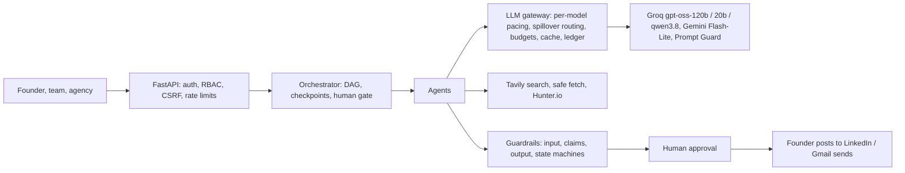

# Growth OS: reviewer guide

A done-for-you growth portal for busy founders: content marketing, personal branding and lead generation. Agents research the founder's market, competitors and voice from real web sources, plan an 8-week LinkedIn calendar, write at least five posts a week in the founder's voice, find qualified leads and draft outreach emails. **The founder only approves, edits or asks for changes; nothing is posted or sent without them.** Built for 12 clients next month, with a tested path to 100.

**Status.** Live at https://growthos-b0t9.onrender.com. 224 automated tests pass (223 on Postgres, where one SQLite-only check is skipped); the eval gate passes offline and live. Measured on real providers (free tiers): research and strategy in **90 s**, a week of posts in **147 s** (5 of 5 ready), a lead run in **18 s** (8 leads, 6 with verified emails): **about 4 minutes end to end**, down from 25 to 35. Not exercised live: sending through Gmail (needs the founder's own Google consent in a browser).

Deeper documents: [Architecture](ARCHITECTURE.md) · [Evals and guardrails](EVALS_AND_GUARDRAILS.md) · [Cost and run time](ECONOMICS.md) · [Deploying](DEPLOY.md) · [Decisions and lessons](../DECISIONS.md) · [Live run report](../loadtest/reports/live-run.md)

## 1. Where each requirement lives

| Requirement | How it is met | Code |
|---|---|---|
| Agentic loops, long-horizon planning | Research decide-act loop, writer and critic, bounded redrafts, calendar repair, goal-seeking lead rounds, learning from edits; an 8-week calendar kept full | `app/agents/` |
| Coordination | Event-driven DAGs with database checkpoints, retries, crash resume, a human approval gate, a fair scheduler across clients | `app/agents/orchestrator/` |
| Voice, industry, competitors, trends, strategy | Research with every claim checked against its source; founders can **suggest changes** before approving | `app/agents/research/`, `app/agents/strategy/` |
| Leads and templated outreach a human approves or edits | Web search + Hunter.io, evidence-backed scoring, email drafts, a send gate | `app/agents/leads/`, `app/services/approvals.py` |
| Content previews for final approval | LinkedIn-style preview cards with the source behind every figure | `app/web/templates/` |
| Evals, cost, guardrails | Offline and live eval gates, a cost ledger, deterministic guardrails | `evals/`, `app/llm/gateway.py`, `app/guardrails/` |
| RBAC, tenant isolation | Deny-by-default policy table, team and admin pages, an ORM tenant interceptor, a 315-check RBAC eval | `app/core/security.py`, `app/db/session.py`, `evals/rbac.py` |
| Stress and performance | 12 and 100 clients through the real orchestrator, with injected failures | `loadtest/` |

## 2. Architecture in one picture



**A fixed workflow with real agents inside each step.** Order, checkpoints, budgets and approvals are deterministic code, so cost is predictable, runs resume after a crash and every gate is testable. Three workflows: research and strategy (once, then an approval gate), posts and calendar (weekly), lead search and outreach (weekly; independent of posts). A run ends `succeeded` only if the client's KPI targets were met; otherwise `succeeded_with_shortfall` with the reasons (for example "4 of 5 posts ready: 1 stayed below the editor's bar").

| Agent loop | Bounds |
|---|---|
| Research: the model picks searches and pages from compact observations, code runs them in parallel, one extraction reads the evidence; every claim is then checked against its page in code | 3 steps, 6-7 pages |
| Writer and critic (different model families), then guard auto-fix, then fresh redrafts told why the last fell short | 2 rounds, 2 fixes, 3 attempts, stop when not improving, 270 s budget |
| Calendar planner: chunks in parallel, validated by code (posts per week, pillar mix, unique topics) | 3 repairs |
| Lead engine: plan queries, search, extract, verify against results, score with quoted evidence, contacts for qualified companies only | 3 rounds, Hunter quota respected |

## 3. Speed and cost (measured live)

| Run | Before | Now | AI cost | Search and contacts |
|---|---|---|---|---|
| Research and strategy | 14-20 min | **90 s** | $0.048 | $0.28 |
| Posts and calendar (5 posts) | part of 20-35 min | **147 s** | $0.016 | $0 |
| Leads and outreach (8 leads, 6 verified emails) | part of 20-35 min | **18 s** | $0.007 | $0.25 |

Why it was slow: free-tier limits are **per model** (Groq: 8,000 tokens a minute) and Groq counts the reserved `max_tokens`, while every step used one model and research re-read every page on every step. The ledger now records each call's model time, pacing wait and 429 wait, which showed this. Fixes: each tier leads with a different model and spills to the next when the first is busy, budgets sized from measured use, a decide-act research loop with one extraction on Gemini, and steps that start as soon as their own inputs are ready.

**Per client per month** (1 research run, 4 post runs, 4 lead runs): about $0.14 of AI, $0.44 of search, $0.83 of Hunter credits, so **about $1.41**, at paid list prices checked on 2026-10-27. On the free tiers the bill was $0. AI is cheap even at frontier prices (Claude Sonnet 5.5: about $0.88 a month; GPT-5.5: about $2.43). **Contact data and hosting decide the margin**: 12 clients cost about $58 a month all-in, mostly a $49 Hunter plan. Full tables in [ECONOMICS.md](ECONOMICS.md).

## 4. RBAC and tenant isolation, proven

Four roles (platform admin, account manager, founder, read-only viewer) in one deny-by-default table; workspace membership is a second, independent check; a grant table says who may hand out which role.

- **Team page:** the founder adds a teammate with an email, password and role, changes roles, resets passwords, deactivates or removes them. The last owner can never be removed or demoted.
- **Admin data view:** read-only users, workspaces, memberships, runs, spend and audit, with search. The admin creates account managers and assigns clients. No hashes, tokens or keys are ever shown.
- **Enforcement:** viewers see everything and get **403 on every write**, API and UI, with a page naming the missing permission. Other workspaces return 404. Sessions are re-checked against the database on every request, so revocation applies on the next click. Cross-site form posts are refused.

| Proof | Result |
|---|---|
| RBAC eval: 9 actors x 35 endpoints (API and UI), hand-written expectations | **315/315** |
| Cross-tenant access violations | **0** |
| Escalation attempts that succeeded (agency roles, self-promotion, forged and stale tokens, last owner...) | **0 of 14** |
| Mutation test: break access control four ways, does the eval notice? | **4 of 4 caught** |
| ORM interceptor: unscoped or unfilterable queries are refused; cross-tenant writes blocked | tested |

## 5. Evals and guardrails

**The model proposes, code disposes.** Guardrails are code: claim-level grounding (every figure needs a verbatim source quote used in the source's sense), research claims checked against their pages (unsupported ones are flagged, never shown as facts; outdated figures labelled), injection scanning with quarantine, leakage, PII and agency-name checks, approval state machines, and a send gate (approval, role, verified recipient, do-not-contact, daily cap, kill switch, row lock against double sends).

| Eval | Result |
|---|---|
| Red team (22 cases incl. benign controls): block recall / false positives | **1.0 / 0.0** |
| Injection recall: offline heuristics / live with Prompt Guard | 0.8 / **1.0** |
| Deterministic quality on the live run's posts: ungrounded figures, safety issues, banned phrases, copies, near duplicates | **all 0**; 5 of 5 at the editor's bar |
| Lead screening: suppressed, competitor and contactless prospects removed / good ones wrongly removed | **1.0 / 0** |
| Judge calibration (live): critic within one point of a human / Spearman | **0.875 / 0.89** (gate 0.75 / 0.6) |
| Stress: 100 clients, mock models with 5% 429s and 2% 5xx | 1,600 steps, **0 failed**, 0 lock errors, 0 cross-tenant, 100/100 met targets, 77 s |

A live run exposed a strict critic that scored drafts it called "solid" at 3.6 against a 4.0 bar, so redrafting could never satisfy it. The rubric is now anchored to the human scale, and its agreement with the hand-scored set went from 0.75 to 0.875.

## 6. Tests

224 tests (`pytest -q`, about 2.5 minutes); the same suite runs on PostgreSQL with `TEST_DATABASE_URL`. Running them on Postgres found two real bugs that SQLite had hidden: a double click sent an email four times, and parallel identical cache writes failed a step. Both are fixed. Coverage: RBAC and revocation, tenancy, the send gate, grounding regressions, research integrity, routing and pacing, orchestration failure and recovery, the weekly-target guarantee, integrations against mock HTTP, migrations matching the models, and a production-mode boot that proves no demo data or mock output.

## 7. Known limitations

| Limitation | Plan |
|---|---|
| Gmail sending is tested against mock HTTP only; Google's testing mode sends only to listed test users | Live test with the founder's own address via "Add a lead manually", then Google app verification |
| Free Render plan: SQLite in `/tmp` is wiped on restart or idle spin-down (a banner says so) | Point `DATABASE_URL` at a free hosted Postgres (supported and tested locally, not yet on a hosted provider) |
| Content runs still wait on Groq's free 8,000 tokens/minute | Paid tier, or more writer models in `ROUTE_BIG` |
| Orchestrator and rate limiter are in-process (one worker) | Durable queue and Redis; checkpoints carry over |
| No LinkedIn publishing (by design); Docker image not built locally (Render builds it) | Founder copies and marks posted |
| Hunter.io free plan is 50 credits a month | Starter plan for 12 clients |

## 8. Run it

```bash
python3 -m venv .venv && .venv/bin/pip install -r requirements.txt
cp .env.example .env                       # keys; use a NEW database file
.venv/bin/uvicorn app.main:app --port 8000
.venv/bin/python -m pytest -q && .venv/bin/python -m evals.run_evals && .venv/bin/python -m evals.rbac_mutations
.venv/bin/python -m loadtest.stress --tenants 100
```
