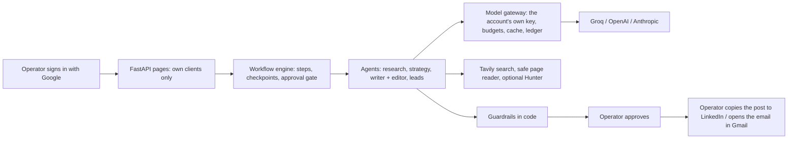

# Growth OS: reviewer guide

A done-for-you growth portal. **One operator** (the agency person doing the work) signs in with Google and runs it for
the founders they work for. For each founder it researches the market, competitors and the founder's voice from real
sources, plans an 8-week LinkedIn calendar, drafts at least five posts a week in that founder's voice, finds companies
that fit with a real way to reach someone there, and drafts short outreach emails. **The operator approves, edits or
rejects everything; the system never posts or sends.** Each operator brings their own AI, search and (optional) contact
keys and pays those providers directly.

Deeper documents: [Architecture](ARCHITECTURE.md) · [Evals and guardrails](EVALS_AND_GUARDRAILS.md) ·
[Cost and run time](ECONOMICS.md) · [Deploying](DEPLOY.md) · [Decisions and lessons](../DECISIONS.md)

## 1. Feedback received and what changed

The first version was turned down with five points. Each one, and what answers it:

| Feedback | What changed | Evidence |
|---|---|---|
| **1. Ask who runs the system.** It is done-for-you: the team operates and approves, not the founder. | The founder-facing roles, team pages, admin console and invite codes are gone. One operator account owns its clients; there are no roles to get wrong. Sign-in is Google only. | `app/api/deps.py` (one ownership rule, `tenant_or_404`); the app code is 218 lines *shorter* than v1 although it gained Google sign-in, three AI providers, own keys and a new lead engine |
| **2. Hold output to a human bar.** Posts read as a generic template; test with real samples and human review, not a model grading itself. | A style card measured from the founder's own posts drives the writer; code (not the model) detects seven generic LinkedIn patterns and blocks them unless the founder writes that way; invented anecdotes and copied sentences are blocked. Measured on six real public writers with a style-distance metric and a cross-client template test. A blind human-rating kit and in-app ratings are built. | [EVALS 2.4](EVALS_AND_GUARDRAILS.md#24-voice-and-template-live-output); **no human has rated the posts yet**, so no claim is made that they pass a human bar |
| **3. Test beyond one example.** A lead run for the reviewer's profile returned zero. | A new lead engine: seven kinds of search, company links mined from list pages, each company's own site read, four contact routes that need no Hunter. Every run shows its funnel (found → dropped, and why); a short week offers *Broaden and retry*. Run live on six different profiles. | [EVALS 2.5](EVALS_AND_GUARDRAILS.md#25-leads-live-output) |
| **4. Click through the live app.** The first sign-up hit a server error. | Every error is a friendly page (no stack traces); a browser test signs in, adds a client, saves a key, runs research, opens a calendar card and the post, uses both outreach buttons and deletes the client; `scripts/check_deploy.py` checks the deployed site. | `tests/e2e/test_browser.py` passes locally. The live click-through on the deployed site **has not been done yet**: it needs the branch merged and the owner to sign in with Google once |
| **5. Stay inside the brief.** | v2 has fewer moving parts, not more: roles, team and admin pages, Gmail sending, password sign-in, the agency all-in-one run and the 100-client stress harness were removed. | `DECISIONS.md` section 0 |

## 2. Status

Measured on 2026-10-29. All v2 work is on the branch `feature/v2-single-user`, **not merged**, so the live site still
runs v1.

| Area | Result |
|---|---|
| Tests | 282; all pass on SQLite. On a Neon Postgres test branch: the full suite, then every file changed afterwards again; all pass except one test that reads SQLite run files and is skipped there. Running on Postgres found two timing assumptions in tests, now fixed |
| Offline eval gate | **PASS** (guardrails, pipeline, quality, account isolation with its mutation test) |
| Data survives a restart on Neon Postgres (production mode, real migrations) | **yes** (`scripts/check_persistence.py`, [DEPLOY.md](DEPLOY.md)) |
| Live runs on six real public profiles (Groq free tier, Tavily) | research and strategy, posts, leads and outreach for each |
| Posts | 56 delivered; 13 of 56 at the editor's bar; closer to their own founder than the template in 56 of 56, but the right founder is the nearest only 27% of the time ([details](EVALS_AND_GUARDRAILS.md#24-voice-and-template-live-output)) |
| Leads | 33 across six profiles, 28 traced to a page naming the company, no invented emails; one profile met the weekly minimum of 10, one found none until broadened ([details](EVALS_AND_GUARDRAILS.md#25-leads-live-output)) |
| Cost | about $0.35 of AI and $1.01 of search per client per month on Groq ([ECONOMICS.md](ECONOMICS.md)) |
| Not verified | human ratings; the deployed site click-through; OpenAI and Anthropic against their own APIs |

## 3. How it works



Three workflows, each a fixed set of steps with real agent loops inside: **research and strategy** (once, then the
operator approves or suggests changes), **posts** (weekly), **leads and outreach** (weekly). Order, checkpoints, budgets
and approvals are code, so cost is bounded, a run resumes after a crash, and every gate is testable. A run that misses
its target ends "succeeded with shortfall" and says why.

## 4. Accounts and keys

- **Isolation.** Every client belongs to one account; someone else's client is a 404. An ORM interceptor refuses any
  query on client data without a client scope. `evals/isolation.py` finds every client route from the app itself and
  attacks it as another account and with forged, expired and stale sessions: 15 routes, 56 checks, **0 violations**;
  its mutation test breaks isolation five ways and **all 5 are caught**.
- **Own keys.** Saved keys are checked with one free call, encrypted with the owner's id bound inside, read by one
  module only, never shown again, scrubbed from errors and logs. A run uses only the key of the account that owns the
  client. Providers: Groq (run live), OpenAI (**protocol verified against an OpenAI-compatible endpoint, not against
  OpenAI**: `scripts/live_adapters.py` passed text, JSON mode, tool calls and a rejected key on Groq's endpoint),
  Anthropic (**contract-tested with mocks, not run against Anthropic's API**). No paid OpenAI or Anthropic key was
  available.

## 5. Tests and evals

282 tests (`pytest -q`); the same suite runs on Neon Postgres. Offline eval gate: **PASS** (red team 22 cases, recall
1.0, false positives 0; isolation as above; deterministic quality all zero). Live: injection recall 1.0 with Prompt
Guard; the editor model agrees with the hand scores within one point 0.75 and 0.875 in two runs (gate 0.75). Details
and the per-file test table: [EVALS_AND_GUARDRAILS.md](EVALS_AND_GUARDRAILS.md).

## 6. Limitations

| Limitation | Why, and what would fix it |
|---|---|
| No human ratings of the posts yet | The blind-review kit and in-app ratings exist; someone has to spend 30-45 minutes rating |
| Live drafts often stay below the editor's 4.0 bar | Measured, not hidden: they are delivered labelled and do not count toward the target. A stronger writer model (a paid key) is the likely fix; not tested |
| OpenAI and Anthropic not run against their own APIs | No paid key; see section 4 |
| Live click-through on the deployed site not done | Needs the merge and one Google sign-in by the owner |
| Groq's free tier makes runs slow (a week of posts takes 7-13 minutes, mostly waiting on the 8,000 tokens a minute limit) and allows about two post runs a day per key | A paid plan or another provider; see [ECONOMICS.md](ECONOMICS.md) |
| The figure check is strict: it blocks some fair uses of a sourced number when the wording around it differs from the source | Kept on purpose (loosening it let a customer count pass as a market size); the writer is told why and redrafts |
| Few profiles reach 10 leads a week; most candidates are judged a poor fit | Every run shows the funnel and suggests what to widen; *Broaden and retry* relaxes region and size |
| Lead review was done by the implementing agent (an AI), not a person | Spot-checking a sample by hand is the next step |
| One web worker; the run engine is in-process | Fine for one operator; a queue would be needed for many |
| Render's free plan sleeps after 15 minutes idle (first request about a minute) | Data is in Neon, so nothing is lost |

## 7. Run it

```bash
python3 -m venv .venv && .venv/bin/pip install -r requirements.txt
cp .env.example .env
.venv/bin/uvicorn app.main:app --port 8000
.venv/bin/python -m pytest -q && .venv/bin/python -m evals.run_evals
APP_ENV=demo DATABASE_URL=sqlite+aiosqlite:///./demo.db .venv/bin/uvicorn app.main:app --port 8010   # labelled demo
```
